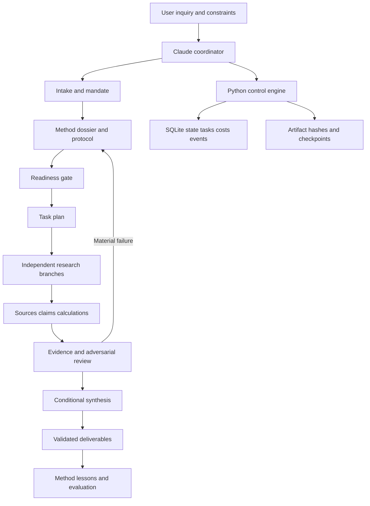

# Architecture and engineering report

> **Historical v2 report.** Retained for provenance, not current Copilot architecture or capability evidence. See [the v4 upgrade](V4_UPGRADE.md) and [current testing](TESTING.md). Platform, model, provider and numerical claims below have not been reverified for v4.

ATLAS 2.0 is a Claude Code workflow backed by a local Python control engine. Claude performs interviewing, reasoning, retrieval and synthesis; Python checks the declared workflow, evidence artifacts and calculations. The boundary is intentional: a passing consistency check never establishes factual truth or comprehensive research.

## Components and data flow

The diagram describes artifact dependencies, not a background service that launches itself. The CLI never calls a model or external API. The coordinator invokes stage skills and permitted tools, writes JSON/Markdown artifacts and requests transitions. Workers return bounded branch results. Only the coordinator mutates project state; worker outputs use separate paths. A coordinator can run a small task sequentially; no minimum agent count is enforced.

| Path | Responsibility |
|---|---|
| `CLAUDE.md` | Always-loaded initialization, lifecycle and safety invariants |
| `.claude/rules/evidence.md` | Short persistent evidence rule |
| `.claude/skills/atlas-*` | On-demand initialization, intake, meta, research, audit and delivery procedures |
| `.claude/agents/` | Five specialized contexts with explicit tools and inherited model |
| `atlas/project.py` | Transactions, gate validation, task DAG, costs, holds, reopen and recovery |
| `atlas/evidence.py` | Source/claim/reference/excerpt/date/lineage/calculation consistency |
| `atlas/quant.py` | Six explicit-input calculators with provenance and units |
| `atlas/io.py` | Bounded strict JSON, atomic JSON writes, confined paths and hashes |
| `atlas/intake.py`, `methods/` | Core/adaptive questions and eight domain method profiles |
| `atlas/integrations.py`, `config/` | Offline discovery, expiring observations, provider candidate catalog |
| `atlas/memory.py`, `memory/` | Reviewed method promotion, version history and expiry |
| `atlas/structure.py` | Shipped metadata subset, Python syntax and local-reference validation |
| `atlas/demo.py`, `scripts/`, `tests/` | Synthetic full lifecycle, adversarial checks and release receipts |
| `projects/<id>/` | Local source snapshots, calculations, state, branch outputs and deliverables |
| `research/`, `reports/`, `reference/` | Dated design evidence, audit, tests and untouched prototype |

## Lifecycle and gates

Installation is global and separate from project state. `init` checks structure and Python, records local capabilities in `.atlas/installation.json`, prints the exact readiness announcement and exits. It creates no research project. A future inquiry creates an isolated project in INTAKE. This local function's behavior is tested; Claude's conversational adherence is unverified.

| Work state | Required before leaving it | Next state |
|---|---|---|
| INTAKE | Recorded essential answers or acknowledged explicit assumptions; deliverables; ended interview; mandate matching saved inquiry | MANDATE |
| MANDATE | Accepted mandate already sealed | META |
| META | Method alternatives, sources, pilot/access limitation, dossier; protocol with coverage, searches, predefined evaluation criteria and bounded meta passes | READINESS |
| READINESS | Seven check categories passed or limited with specific fallback; no blocked requirement; capability validity | ORCHESTRATE |
| ORCHESTRATE | Task objectives, evidence requirements, owners, acyclic dependencies and model policy | RESEARCH |
| RESEARCH | Finished tasks with matching actual output hashes; complete coverage/gap accounting and search log | VERIFY |
| VERIFY | Nonempty evidence registry passing mechanical checks; independent review record; explicit critical-issue clearance; freshness resolution where needed | SYNTHESIS |
| SYNTHESIS | Known claim IDs, conclusion, tradeoffs, uncertainty, failure conditions and strongest counterargument | DELIVER |
| DELIVER | Actual nonempty hashed files with contract, format and citation review | MEMORY |
| MEMORY | Lesson outcome and reviewed proposals, including an explained empty list when appropriate | EVALUATE |
| EVALUATE | Predefined criteria assessed, actual results/failures/limits/next actions; no false claim that local checks prove research quality | COMPLETE |

`hold` records paused, blocked or aborted status without losing the underlying stage. Work-changing commands reject a held project until an explicit reasoned resume. A hold cannot terminate external jobs; those must be cancelled in their actual runtime. `reopen` records an amendment reason, returns to an earlier stage and removes downstream acceptance. It does not delete evidence or disguise earlier errors. Old files must be corrected/reviewed before the affected gates can pass again.

## Intake and meta-research

The engine stores every answer and additional question. Sixteen general dimensions plus relevant domain questions form a starting bank, not a fixed interview script. Claude should acknowledge answers already present, ask useful batches, distinguish essential/optional and generate follow-ups. The user may stop the interview with explicit assumptions. Missing consequential answers cannot be silently guessed. Deliverables are an essential field, and formats are expressly asked.

The methodology dossier compares at least two alternatives, including a simpler approach, with evidence and feasibility. The protocol contains inclusion/exclusion, search plan, coverage, verification, stopping and amendment policies. One to three preparation passes is a recursion bound, not an optimum. A representative pilot should test actual data/extraction when possible; inability to pilot must be recorded. The gate checks record structure, not whether an external search truly happened.

## Evidence and review contract

A source record includes URL/local identifier, access date, origin group, snapshot path and SHA-256. Optional publication/expiry fields separate chronology from freshness. Claim records carry atomic wording, kind, materiality, author and source IDs. Assessments pair a claim with a source, an exact excerpt/location, support verdict, reasoning and reviewer identity. Matching quotes and different names are necessary records; they do not authenticate independent people or establish entailment.

Duplicate bytes assigned to different origins fail; other duplicate or derivative reporting still requires source tracing. Public source URLs reject obvious reserved/test/private literal IP forms, but the engine does not resolve DNS or establish source reputation. It makes no network request. Local evidence needs a provenance note and is visibly flagged.

Calculation artifacts contain the exact input and recomputed result. Claims bind to a JSON pointer and expected unit label. A valid calculation cannot support an unrelated number. Reported statistics may bypass a calculation only with explicit labeling and source review. Arithmetic reproduction does not validate the source inputs, fees, probability distribution or decision model.

The synthesis gate requires a distinct reviewer label and explicit clearance of critical failures. An actual independent source-grounded review is still the coordinator's duty. For high-stakes work the protocol can require a qualified human. No automatic semantic truth score, source ranking magic or majority-vote fact certification is implemented.

## Reliability and recovery

SQLite provides transactional state/task/cost updates. Event receipts hash the state and ledger content, chaining prior receipts. Accepted artifacts are sealed by stage. This detects accidental changes and inconsistent updates; a malicious filesystem owner can rewrite the whole history. Hashes are not signatures.

Each successful stage transition produces a database checkpoint via SQLite backup. A manual checkpoint can be requested at any time. Restore checks its hash, database integrity and event chain, preserves the previous database, then records restoration. Stop all writers before restore. Checkpoints do not back up source/output files; make whole-project backups separately. A failure after the database commit but before checkpoint creation may leave a valid advanced state with a reported checkpoint error: inspect status and run `checkpoint` before retrying the stage. Idempotent stage/cost calls prevent ordinary duplication, not remote billing duplicates.

Task attempts are capped at three; dependencies must finish first, and completed output files must exist and match hashes. There is no automatic retry scheduler, daemon or queue. Costs are local declared amounts under the sealed mandate. The engine performs no purchases and cannot intercept spending by external tools. Remote idempotency keys and ambiguous timeout recovery belong in future tested provider adapters.

## Memory and versioning

Project evidence stays in its project. Method memory requires an explicit proposal, distinct reviewer, validation receipt/hash and expiry. Promotion writes a new version and preserves the old one. Retrieval excludes expired methods and uses transparent lexical matching. A record can still be dishonest; the validator does not authenticate identity or experiment quality. Core code changes are explicit, tested and reversible; no automatic self-modification runs.

## Design alternatives and tradeoffs

The monolithic master is excluded from active context; the full prototype remains in the reference ZIP. Eight agents become five because source/tool scouting is part of method planning and synthesis remains coordinator-owned. Frameworks, vector memory, automatic MCP installation, external telemetry, API clients and a model-facing entailment judge are deferred until a specific measured requirement justifies them. This reduces untested dependencies at the cost of requiring manual orchestration and setup.

The repository is intended to run from its extracted root. Its standard-library engine requires no `pip install`. The metadata in `pyproject.toml` describes the code; a standalone wheel would not supply all project instructions/method files and is not the supported distribution. Python 3.10+ syntax is used; execution was tested only on 3.12.14/Linux. Real Windows/macOS, cloud Claude sessions and other Python versions remain unverified.

[Research justification](RESEARCH_REVIEW.md), [artifact contracts](../docs/SCHEMAS.md), [security](../docs/SECURITY.md), [tests](TESTING.md) and [roadmap](LIMITATIONS.md) explain the evidence and limits.
